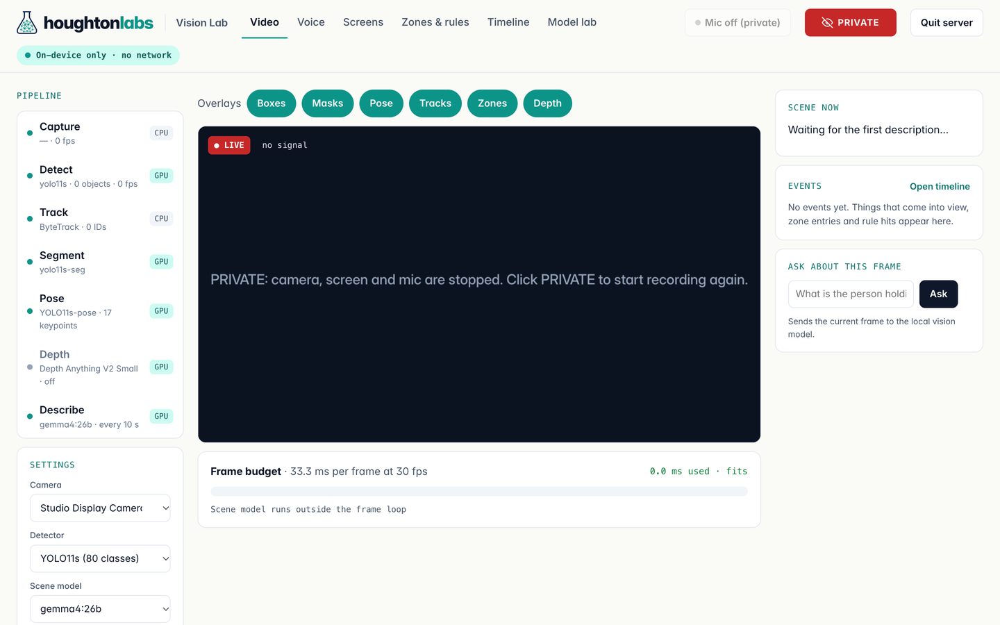
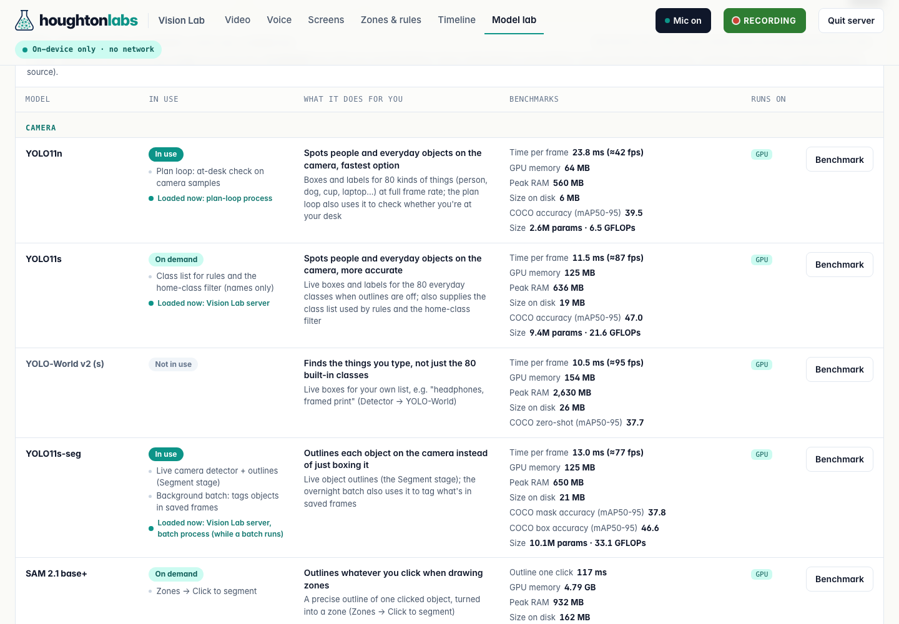
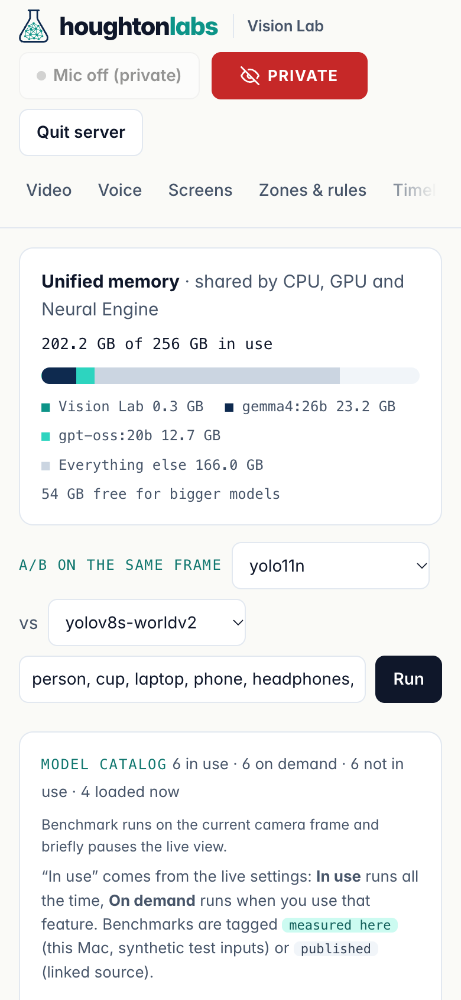
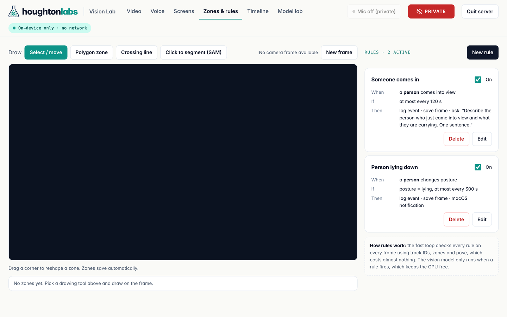

# Vision Lab

Vision Lab turns a Mac into a private, on-device timeline of what your camera sees, what is on your screen and what you say. It runs every model locally on Apple Silicon (detection, tracking, pose, segmentation, a vision-language model, speech-to-text and text-to-speech) and stores everything in a local SQLite database. Nothing is uploaded.



## What it does

| Tab | What you can do |
|---|---|
| **Video** | Live camera feed with overlays you can switch on and off (boxes, masks, pose skeletons, track trails, zones, depth). Each pipeline stage shows what it costs per frame. A local vision model describes the scene every few seconds, and you can ask questions about the current frame. |
| **Voice** | Talk to a local model out loud: Silero VAD for turn-taking and barge-in, mlx-whisper for speech-to-text, an Ollama model for the reply, Kokoro for the voice. In recording mode, what you say is transcribed into a searchable voice log. |
| **Screens** | Periodic screenshots, captioned by a local vision model. Screen captures are tagged sensitive and are never exported. |
| **Zones & rules** | Draw polygon zones and crossing lines, or click an object to outline it with SAM 2.1. Build rules such as *"a person comes into view → save the frame and ask the vision model to describe them"*. |
| **Timeline** | Search saved keyframes with plain text (SigLIP embeddings), see activity across the day by type, and have a local LLM summarize or answer questions about the log. |
| **Model lab** | A catalog of every model the app uses: whether it is in use, on demand or not in use, whether it is loaded right now, what it does in plain words, and benchmarks labeled as *measured here* or *published* (with a source link). Also unified-memory use and an A/B detector comparison on the same frame. |



## Privacy

- **One switch.** The header toggle shows green **RECORDING** or red **PRIVATE**. Private stops the camera (the device is released, so the light goes off), screen capture and the mic together, while the server keeps running. The button only shows state the server has confirmed.
- **Local only.** The server listens on `127.0.0.1`. Models run on the Mac through PyTorch (MPS), MLX and Ollama.
- **Redaction.** Window titles and text that look like messaging, banking or other personal content are skipped or masked before they are stored. You can add your own terms in untracked local files (`data/redaction_terms.txt`, `data/redaction_title_terms.txt`).
- **Your data stays out of git.** `data/` (database, keyframes, logs) and `weights/` are git-ignored. Mic audio, if you keep it, goes to `VLAB_AUDIO_DIR` outside the repo.

## How it works

```
Camera ─► fast loop (every frame): YOLO11 detect/segment + ByteTrack + YOLO11-pose ─► zones & rules ─► SQLite event log
                                                     │ rule fires / every N seconds
                                                     ▼
                         slow loop: Ollama vision model describes or answers ─► event log
Screen ─► screenshots / screen video ─► local captions (sensitive, never exported)
Mic    ─► VAD ─► mlx-whisper ─► voice log (junk/hallucination filter) ─► event log
                       keyframes ─► SigLIP embeddings (text search)   ·   LLM summarizes the day's log
```

On an M3 Ultra the fast loop runs at about 30 fps at 960 px input. More detail: [docs/architecture.md](docs/architecture.md) and [docs/event-model.md](docs/event-model.md).

| Model | Job |
|---|---|
| YOLO11 (detect, seg, pose) + ByteTrack | People and objects, outlines, posture, track IDs |
| YOLO-World | Open-vocabulary detection ("find the things you type") |
| SAM 2.1 | Click-to-outline zones |
| Depth Anything V2 | Optional depth overlay |
| SigLIP | Text search over saved keyframes |
| Ollama vision model (e.g. `gemma4:26b`) | Scene captions, questions, summaries |
| mlx-whisper large-v3-turbo · Silero VAD · Kokoro | Speech-to-text, turn-taking, text-to-speech |

## Requirements

- macOS on Apple Silicon
- [uv](https://github.com/astral-sh/uv) and `ffmpeg`
- [Ollama](https://ollama.com) with a vision model, e.g. `ollama pull gemma4:26b` (a smaller one such as `qwen3-vl:8b` works too)

## Run

```bash
./run.sh
```

Or double-click **`Start Vision Lab.command`** in Finder. Then open <http://localhost:8765>. The first run creates `.venv`, installs dependencies and downloads the YOLO and Kokoro weights. SAM, Depth Anything and SigLIP download the first time you use them. macOS asks for camera, mic and screen-recording permission for the app that launched the server.

Optional: `macapp/build.sh` builds a small `Vision Lab.app` that owns the server processes, so macOS permissions stick to one stable app. Set `VLAB_REPO` if your checkout isn't at `~/vision-lab`.

Useful settings:

| Variable | Effect |
|---|---|
| `VLAB_SOURCE=/path/to/video.mp4` | Use a looping video file instead of the camera |
| `VLAB_NO_CAMERA=1`, `VLAB_NO_MIC=1`, `VLAB_NO_SCREEN=1` | Turn a capture source off |
| `VLAB_DB=/tmp/test.db` | Use a separate database (e.g. for tests) |
| `VLAB_RECORDING_MODE=0` | Turn off recording mode (camera video, mic and screen together) |
| `VLAB_AUDIO_DIR`, `VLAB_AUDIO_RETAIN=0` | Where kept mic audio goes, or don't keep it |

Find a moment by what you said, and optionally export the clip:

```bash
bin/vlab find "the part where I set up the zones" --days 7
```

## Tests

The tests use synthetic data and temporary databases. Some run against a test server started with `VLAB_NO_CAMERA=1 VLAB_DB=/tmp/x.db`, for example `.venv/bin/python tests/model_catalog.py`.

Before publishing, `scripts/publish_gate.sh` runs gitleaks and a PII scan (emails, phone numbers, home paths and your local term lists).

## Layout

```
vision_lab/
  engine.py      camera thread, model pipeline, tracker, zones/lines/rules, VLM + embedding workers
  server.py      FastAPI: WebSocket stream and REST API
  recording.py   recording mode: camera video, mic and screen on one switch
  screenrec.py   scheduled screen video        voicetx.py / voicelog.py   mic transcription and voice log
  catalog.py     Model lab catalog              redaction_pack.py         privacy filters
  store.py       SQLite schema and queries      static/                   single-page UI
bin/vlab         command-line search over the voice log
data/            created at runtime (git-ignored)
weights/         downloaded model weights (git-ignored)
```

## Notes and limits

- Posture (standing, sitting, lying) comes from pose keypoints with a simple angle rule, so it reads "unknown" when legs are hidden.
- Track IDs can change after a long occlusion.
- Be mindful of other people when recording.

 

## License

MIT. See [LICENSE](LICENSE).
