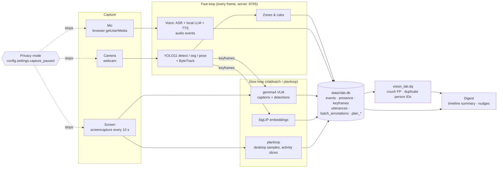

# Architecture

All processing is on-device (Mac Studio, M3 Ultra). Nothing leaves the machine.

- **Fast loop**: per-frame detection/tracking in the server process; writes `events` and `presence`, saves keyframes.
- **Slow loop**: `vision_lab.batch` (gemma4) captions keyframes and screen captures into `batch_annotations`; SigLIP embeds keyframes for text search; `planloop` samples the desktop and produces activity slices and nudges.
- **Storage**: one SQLite file; schema in [event-model.md](event-model.md).
- **DQ**: `python -m vision_lab.dq` (read-only) measures detector false positives and tracker ID churn; see [dq.md](dq.md).
- **Digest**: timeline LLM summary and planloop nudges read from the same DB.
