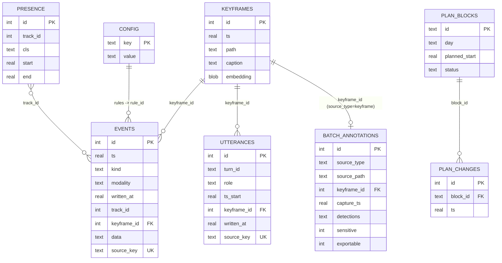

# Vision Lab event model (HOU-84)

Everything Vision Lab and its workers observe lands in one SQLite file, `data/vlab.db` (git-ignored, local only).
This page documents the tables, keys and links between them. A synthetic copy with the same schema lives at
`tests/fixtures/vlab_fixture.db`, generated by `tests/fixtures/make_fixture.py` (fake rows only; no home data).
`tests/event_model.py` fails if the fixture drifts from the live schema.

## Writers

| Writer | Process | Tables |
|---|---|---|
| `engine.py` / `store.py` (fast loop, every frame) | Vision Lab server (:8765) | `events` (track, scene, zone, line, rule, posture, snapshot, record, capture_paused/resumed), `presence`, `keyframes` |
| `llm.py` embedder | server | `keyframes.embedding` (SigLIP base, 768 × float32 = 3072 bytes) |
| `voice.py` / `multimodal.py` | server | `utterances`, `events` (modality `voice`, `audio`) |
| `planloop.py` | planloop worker | `events` (modality `desktop`, `activity`; `frame_probe`), `plan_blocks`, `plan_changes` |
| `batch.py` (slow loop, gemma) | vlabbatch worker | `batch_annotations` |
| UI / API | server | `config` |

## Tables

### `events` — the unified timeline
| Column | Notes |
|---|---|
| `id` INTEGER PK | rowid |
| `ts` REAL | when it happened (epoch seconds) |
| `kind` TEXT | e.g. `track`, `scene`, `rule`, `zone`, `line`, `posture`, `desktop_sample`, `frame_probe`, `activity_slice`, `nudge`, `sound`, `interrupt`, `capture_paused` |
| `modality` TEXT, default `vision` | `vision`, `desktop`, `activity`, `audio`, `voice` |
| `written_at` REAL | when the row was written; `written_at - ts` is ingest lag. NULL on older fast-loop rows |
| `track_id` INTEGER, `cls` TEXT | tracker ID + class for `track`/`zone`/`posture` events → `presence.track_id` |
| `keyframe_id` INTEGER | → `keyframes.id` (set on `rule`, `snapshot`) |
| `vlm_text` TEXT | slow-loop description attached after the fact |
| `rule_id` TEXT | → rule in `config['rules']` |
| `data` TEXT (JSON) | structured payload; shape depends on `kind` (e.g. `frame_probe.boxes[]`, `sound.label/confidence`) |
| `source_key` TEXT UNIQUE | idempotency key for imported rows (JSONL import, workers); NULL for live fast-loop rows |
| `text`, `color` | human-readable line + UI colour |

Indexes: `events_ts(ts)`, `events_modality_ts(modality, ts)`, unique `events_source_key(source_key)`.

### `presence` — open/close spans per track
`id` PK, `track_id`, `cls`, `start`, `end` (NULL while the object is still in view). Index `presence_start(start)`.

### `keyframes`
`id` PK, `ts`, `path` (JPEG under `data/keyframes/`), `caption` (VLM), `embedding` BLOB (SigLIP, float32).

### `utterances` — voice turns
`id` PK, `turn_id` (groups the user + assistant halves of a turn), `role`, `text`, `ts_start`, `ts_end`, `voice`, `model`,
`latencies` (JSON), `interrupted`, `error`, `keyframe_id` → `keyframes.id` (the frame the user was looking at),
`snapshot`, `written_at`, `source_key` UNIQUE. Index `utterances_ts(ts_start)`.

### `batch_annotations` — slow loop output
`id` PK, `source_type` (`keyframe` | `screen`), `source_path`, `keyframe_id` → `keyframes.id` (keyframes only), `capture_ts`,
`processed_ts`, `created_at`, `model`, `caption`, `label`, `detections` (JSON `[{cls, conf, box:[x1,y1,x2,y2] normalised}]`),
`gemma_ms`, `detect_ms`, `status`, `error`, `sensitive`, `exportable` (HOU-68: screens are `sensitive=1, exportable=0`).
Unique `(source_type, source_path)`; index `batch_ann_capture(source_type, capture_ts)`.

### `plan_blocks` / `plan_changes` — planloop
`plan_blocks.id` TEXT PK (day, task, Linear issue, planned window, status…); `plan_changes.block_id` → `plan_blocks.id` (audit trail).

### `config` — key/value JSON
`settings` (incl. `capture_paused` for Privacy mode), `zones`, `rules`, `mic_enabled`, `mic_device`.

## Utterance ↔ keyframe links
Every utterance carries `keyframe_id`, so a voice turn can be shown with the frame it was about, and the keyframe's
`caption`, `embedding` and `batch_annotations` row become context for that turn. Events link the same way
(`events.keyframe_id`), so a timeline query can join voice, rules and captions on one keyframe.

## Volumes (aggregate counts, live DB, 2026-10-14)

| Table | Rows |
|---|---|
| events | 95,577 (vision 86,417 · desktop 8,248 · activity 829 · voice 64 · audio 19) |
| presence | 33,042 |
| keyframes | 6,244 (all embedded) |
| utterances | 256 (128 turns; 100% linked to a keyframe) |
| batch_annotations | 2,972 (2,258 keyframe · 714 screen) |
| plan_blocks / plan_changes | 14 / 14 |
| config | 4 keys |

Notes: `written_at` is set on 56% of events (older fast-loop rows predate it); `source_key` is only set on imported rows.
`keyframe_id` is not a declared foreign key (SQLite FKs are off); integrity is checked in tests on the fixture.
